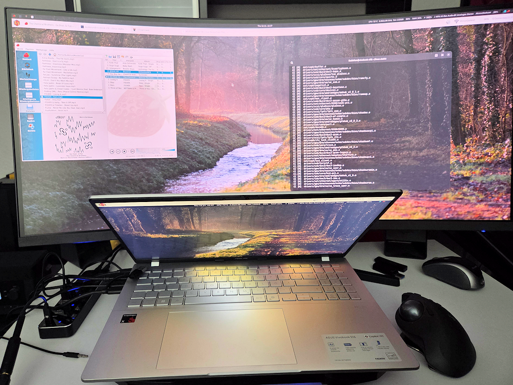

# asus-vivobook-s16-linux

### What's this?

This is the modification of (Debian) Linux (Trixie) (by means of a patchset) for the **ASUS Vivobook S16** (ARM64 aka AArch64).

The ASUS Vivobook S16 is currently not natively supported by Linux. The reasoning is simple: This notebook comes with Windows on ARM pre-installed. If you just download a stock-Debian Linux installer image, then this will not run without modifications. This git repo provides everything you need to make this happen.

On this photo, you see my ASUS Vivobook S16, an external 34" monitor is connected via HDMI. Wayfire with full 3D support running, Strawberry MP3 player works well using the headphone jack with either headphones or external speakers (in the background). The subwoofer is not shown here (under the desk). The trackball is an MX ERGO connected via Bluetooth. The WIFI is currently active and connected to my router (a Fritzbox, 1 GBit/s, TV cable router, Fiber-To-The-Building).

External USB hub on the lefthand side helps me connecting external Thunderbolt/USB SSDs because this does not natively work on this ARM notebook.

### The story behind it

The majority of my machines is based on the X86-64 architecture (both Intel and AMD machines). It is very easy to run Linux on such a box because of the ACPI 'Advanced Configuration and Power Interface', see https://uefi.org/sites/default/files/resources/ACPI_Spec_6.6.pdf (Version 6.6).

The Linux OS kernel needs to  'know' how the hardware of your machine is organized, i.e. e.g. how many CPU cores, how much RAM, what kind of network interfaces (LAN/WIFI), sound, graphics, etc. For X86-64 PCs, this is performed on MS Windows and on Linux by inspecting the so called 'ACPI tables', which gives the OS exactly that kind of information during booting.

Things change dramatically if you want to run Linux on ARM64 (officially called 'AArch64' architecture): Yes, there is recent support for ACPI also on ARM (see https://docs.kernel.org/arch/arm64/arm-acpi.html) but as far as I understand it, it is mainly dedicated to server machines than to notebooks.

To make a long story short, there is a competing technology for Linux called 'device trees' (see https://github.com/devicetree-org/devicetree-specification/releases/tag/v0.4). A device tree is some kind of text file describing all aspects of your machine's hardware in detail. These files have the extension '.dts' and get compiled into binary versions ('.dtb') e.g. during Linux kernel compilation.

In the GRUB2 (GRand Unified Bootloader), you have to specify the device tree to be used for booting that specific machine.

#### Hey, wait, isn't there already device tree support for ASUS in the vanilla kernel?

Yes, it is. But not for the ASUS Vivobook S16. One of the closet machine support is available for, is the ASUS Vivobook S15. But the CPUs (more exact, this is an SoC = 'System on a Chip') are different. Another useful device tree in the Linux Kernel is for the ASUS Zenbook A14.

The ARM SoCs we are talking about here are 'Qualcomm Snapdragon X'. Several different (more or less powerful) versions of this SoC exist. The biggest ones have 18 cores, the SoC in the ASUS Vivobook S16 has eight cores, which is more than enough IMHO. It is a cheaper device compared to the other ones (I bought it in Germany for 799 €).

There are only 16GB RAM soldered on this device, which cannot be extended. The good news are: This machine does not necessarily need more running on Linux than on MS Windows - several times, I reached already the memory limits on Windows, never on Linux.

#### What do I get, what hardware components are supported?

The ASUS Vivobook S16 runs 'smoothly' (tested two weeks now). The Video encoder does not work (firmware issue) - I think, we can live without it - and the notebook camera support is missing:

| Function                                               | Status                                                       |
| ------------------------------------------------------ | ------------------------------------------------------------ |
| 8 CPU cores, cpufreq                                   | ✅ `CONFIG_ARM_SCMI_CPUFREQ` (710 MHz – 2.96 GHz); throttling at 90 °C via DT |
| NVMe (Gen4 x4)                                         | ✅ 7.3.3: QREF rails `always-on`; linux-next: QREF via `&tcsr`, no workaround, no `clk_ignore_unused`/`pd_ignore_unused` |
| Internal display (BOE NE160QDM-NX4, 0x0d25), backlight | ✅ with the `panel-edp.c` entry                               |
| GPU (Adreno X1-45)                                     | ✅ OpenGL 4.6 + Vulkan (Mesa ≥ 25.2 from backports)           |
| HDMI                                                   | ✅                                                            |
| Keyboard, touchpad, lid                                | ✅                                                            |
| USB-A left/right, USB-C (10 Gbit/s, dock, hub)         | ✅                                                            |
| USB4/Thunderbolt                                       | ❌ not supported on Snapdragon X under Linux yet (Thunderbolt/USB SSD enclosures only via hub/USB-A); tried to connect an external SSD (combined Thunderbolt/USB enclosure), which did not work directly but via an intermediate USB hub |
| Wi-Fi (WCN6855 NFA765, ASUS `board.bin`)               | ✅ 7.3.3: DT `firmware-name`; linux-next: ath11k patch        |
| Bluetooth (WCN6855)                                    | ✅ (Bluetooth LE mice need `CONFIG_UHID`)                     |
| Battery / charging                                     | ✅                                                            |
| Speakers (2× WSA8845)                                  | ✅                                                            |
| Headphone jack incl. jack detection                    | ✅ with the ASoC line-out patch; PipeWire switches automatically; tested with headphones and a combination consisting of two speakers with a subwoofer |
| Internal microphones                                   | ⏳ not yet tested                                             |
| EFI variables / `efibootmgr` / RTC                     | ✅ with the `qcom_scm.c` patch                                |
| Secure Boot (own keys, signed UKI with DTB)            | ✅PLEASE DO NOTE: UEFI secure boot currently switched off, no secure boot thorougly tested so far!!! |
| Video codec (iris)                                     | ❌ firmware rejected; not enabled, `qcom_iris` blacklisted    |
| Fan control                                            | ✅ with the ASUS EC driver; fan off at idle (external contribution, see markdown files here!) |
| Keyboard backlight, Fn keys                            | ✅ via `hid-asus-ec` (is part of the external contribution, together with fan control) |
| Suspend/resume                                         | ➖ deliberately not used (suspend masked, lid only locks); hibernation is an open item on most ARM SoC based notebooks, as far as I know |
| DT schema check                                        | ✅ no warnings                                                |
| Upstream                                               | 📨 submitted 13 Nov 2026; v2 prepared after review round 1    |

#### Partner in crime: Anthropic Claude

Did I author the device tree for the ASUS Vivobook S16 myself? No. I intensively collaborated with the AI, Anthropic Claude. Some parts were performed by me (e.g. reading of ACPI tables on MS Windows on ARM using Intel's acpica tools - see https://github.com/open-acpica/acpica).

Furthermore, I extracted all required binary firmwares from MS Windows (injecting them into Linux), I built all Linux kernels, checked kernel logs (dmesg), executed the kernels on my machine. I reviewed all decisions and contributions made by Claude.

Please note: There is NO simple converter from ACPI to device tree available, and, probably there will never be one automating everything. ACPI and DT are too different! The closest one I have found on GitHub (may be used as a starting point for creating such a converter) is this: https://github.com/Sky1-Linux/acpi-to-dts-tools

*What does 'Claude' itself says about the collaboration, cite:*

|           | Claude                                                       | You                                                          |
| --------- | ------------------------------------------------------------ | ------------------------------------------------------------ |
| ACPI/DT   | disassembled and analyzed the ACPI tables, drafted the DTS (pin mapping, regulators, USB repeaters, audio, thermal) | provided the ACPI dumps and Windows firmware, decided what goes in |
| Debugging | evaluated dmesg logs, derived hypotheses (QREF, NFA765 firmware, jack line-out), and was wrong several times | ran every test on the hardware (cold boots, gpiomon, test DTBs, evtest), reported the results, caught errors |
| Patches   | drafted the code changes and commit messages, prepared the split for upstream | wrote the panel entry yourself, reviewed everything, built and tested on 7.3.3 and linux-next, resolved conflicts, submitted, answered reviewers |

The AI (Anthropic’s Claude) did most of the analysis and drafting: it analyzed the Windows ACPI tables, 
drafted the device tree and the small driver changes, and interpreted my logs. I did the hardware side and the judgement: 
every change was built and tested by me on the device (7.3.3 and next-20261112), I reported what worked and what didn’t, 
caught several wrong assumptions, wrote the panel entry myself, and reviewed every patch before sending.

*END OF CITATION*

#### I am curious: What is upstream now?

I began with Linux 7.2.x, continued with Linux 7.3.3, came to Linux 7.4.0-RC2. With each newer Linux version, it became better because especially the Linux 7.4.x kernel defines a lot of useful stuff for this project. Debian Trixie (13) comes with a 6er Linux kernel, i.e. we have to compile our own Linux 7.4.x (or maybe 7.5 once it arrives) to run Debian Linux Trixie on the ASUS Vivobook S16.

A patchset of five patches was submitted by me to different kernel maintainers. Until now (Nov. 2026) only one of them is approved and will go into Linux 7.5. The AI bot checking submitted device trees (new ones) complained already about the sorting of the elements in the DT, which have been corrected already.

Currently, I am waiting for comments from the maintainers to submit a version two (2) of the DT.

For the present, you have to live with the patches provided by this GitHub repo. The process of submitting Linux Kernel patches is, for me, '*pain in the a..*'.

#### Okay, I'm convinced - what's next?

There is a collection of markdown files in this repo. Please read them entirely. They guide you through the process.